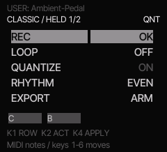

# NJA TACK for M-Wave FM-1

**Free, open-source firmware under GPL-3.0-only. Harmony moves, played MIDI, one small instrument.**

NJA TACK is an independent, Felucca-derived firmware project for the **M-VAVE FM-1**
(often written “M-Wave”). NJA is the project branding; upstream authorship and
third-party licences remain intact. No affiliation with or endorsement by M-VAVE,
Hügelton Instruments or a firmware listing service is implied.

## Current candidate: 6.28-rc5 / FM-1_65262805

Repository: <https://github.com/NjamesZ/nja-tack-fm1>

Experimental review candidate. This is the public source tree for that candidate.
There is no git tag, no GitHub Release, and no Firmware Hub listing.

RC5 carries the LOOP display cleanup, release documentation, the long identity
FM-1_65262805, and app acceptance of both known 1 MiB flash chips. The firmware
sources and the two package files under [release/6.28-rc5/](release/6.28-rc5/)
are the reviewed bytes. They were not rebuilt for this import.

On 10 November 2026 at 11:32 HKT, one controlled install of this exact package
succeeded. After reboot, an independent handshake reported the running identity
FM-1_65262805. RC3 (FM-1_991) had already been user-tested, with positive
subjective feedback (“Love it”). That record does not establish RC5 audio,
hardware timing, the shared voice budget, or the exact-file install and recovery
matrix. Still open: an RC5 listening test; timing and voice-budget measurements;
install of this exact file from official V15 and from another custom firmware;
leaving RC5 for another firmware; USB enumeration; and a controlled
interrupted-write recovery. See [test status](docs/TESTING.md).

Checked publication bytes:

| File | Bytes | SHA-256 |
| --- | ---: | --- |
| `release/6.28-rc5/felucca-6.28-rc5.fwsc` | 610090 | `31067498546ad7ac619987b1499ba61fb95f51ac7a13386bf3a0e3eb8bf5adc3` |
| `release/6.28-rc5/felucca-6.28-rc5-app.bin` | 457268 | `d8dba643ea1004572f45a73f25379f8e496261d15d5b5367d2219fe22b6e6628` |
| `release/6.28-rc5/nja-tack-6.28-rc5-source.tar.xz` | 4642208 | `dc288b502ed801ab981e64791b860a4757c0616464a34e0a5f9abcbe2c898713` |

The source archive is the sealed pre-adaptation tree. Documentation links and the
10 November install record were applied on top of it; firmware C, assembly, and
binaries were not edited. Notes and the local checksum files are in
[release/6.28-rc5/PRERELEASE-NOTES.md](release/6.28-rc5/PRERELEASE-NOTES.md).

## What TACK does

- Keys **1–6** pick harmony moves. They stay harmony choices during recording.
- Played notes follow the selected scale and root (nearest absolute note; ties go lower).
- Overlapping notes whose onsets fall in an **80 ms** window anchored at the
  first onset keep their literal pitches, including voicing. The window does not chain.
- Legato, and any later overlap outside that window, follows the scale.
- At most **four** concurrent recorded MIDI voices. A take that exceeds the voice
  limit, or the other capture limits, is rejected as a whole (`REC FULL`).
- LOOP replays performed note timing; APPLY writes patterned four-slot harmony.
- In-RAM A/B and undo retain user-owned/literal slot metadata.
  New raw timing, channel ownership, and literal-voicing metadata are RAM-only.
- The underlying Felucca sound engines, sounds, drums and effects remain credited
  in [CREDITS.md](CREDITS.md). Host simulation is not a sound-quality guarantee.

## Start here

1. Read [installation and recovery](docs/INSTALL.md); keep your known-good package.
2. Use [quick start](docs/QUICKSTART.md) after installing a separately approved build.
3. Read the [control guide](docs/CONTROLS.md) and [recording policy](docs/RECORDING.md).
4. For developers: [BUILDING.md](BUILDING.md), [test status](docs/TESTING.md),
   [source provenance](docs/SOURCE-PROVENANCE.md), [changelog](CHANGELOG.md).

The image is a 240 × 218 crop of the actual 240 × 240 firmware framebuffer,
rendered by `tests/tack_ui_review.c` using the real drawing code and fonts.
It is not a mockup, device photo or audio test.

## Important limits

- The chord window is **80 ms from the earliest onset**, with actual overlap;
  it is not an indefinitely chained window. Legato notes outside it remain melody.
- **Four simultaneous recorded MIDI voices**, 32 raw notes, 16 combined
  classified/move events and 64 pending MIDI messages. Overflow rejects the
  whole capture as `REC FULL`; it does not silently trim a successful take.
- New raw timing, channel ownership and literal-voicing metadata are **RAM-only**.
  Legacy project/phrase export does not preserve a complete performed MIDI clip.
- Shared eight-voice synthesis budget: other parts, stealing, scheduling and
  UI load still need wider hardware measurements. No sample-exact timing claim.
- Don't route MIDI output back into input. Arbitrary external loopback is input;
  internal LOOP playback is not fed back into the recorder.
- Known inherited host-test failures and unresolved sanitizer timeouts remain.

## Firmware Hub prerequisites

The prior short RC3/RC4 IDs overlap another project’s declared Hub range. They
remain historical local-only trial/review builds, not public release identities.
RC5 uses FM-1_65262805. When that identity was chosen, the public checker’s
live-catalog rules reported it free. That check is not a reservation; repeat it
before any future listing. Root `fmhub.json` keeps a factual, non-advertising
card and a relative image path. It has no play, editor, or sheet URL, because
none was supplied. A repository field is not part of the card schema, so the
repository address lives in this README. Public tag, GitHub Release, default-branch
listing checks, and the exact-file install/leave matrix are still open. See
[Hub readiness](docs/HUB-READINESS.md). Back up before any firmware change.
Project and sample compatibility with other firmwares is not established.
No VIBE, plugin, or conversion compatibility is claimed.

## Free software and complete source

There is no purchase or paid tier in this project. You may use, study, modify and
redistribute it under the applicable licences. The main application is
**GPL-3.0-only**; bundled components retain MIT, Apache-2.0, OFL and CC0 terms.
See [LICENSE](LICENSE), [LICENSING.md](LICENSING.md), [LICENSES/](LICENSES/) and
[CREDITS.md](CREDITS.md). Free does not mean warranty or guaranteed compatibility.

Distribute the matching full source archive and licence files with binary
releases, including the populated `firmware/engines/` directory. A source-only
forge ZIP is not a substitute if it omits engines. Toolchain and SDK prerequisites
are documented rather than bundled. Firmware installation is at your own risk.
